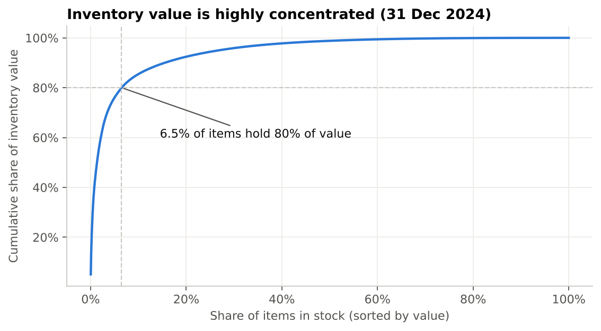
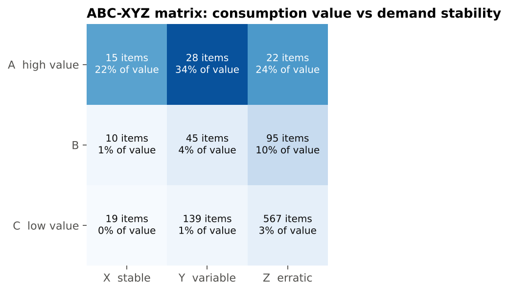
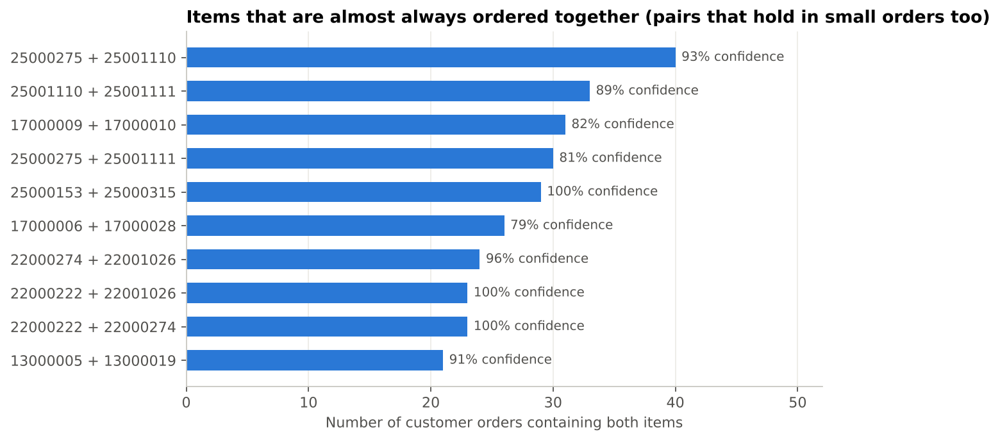
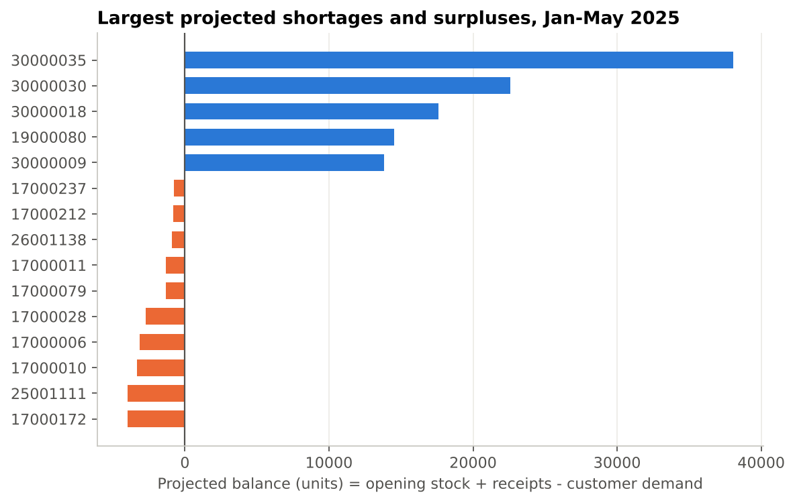
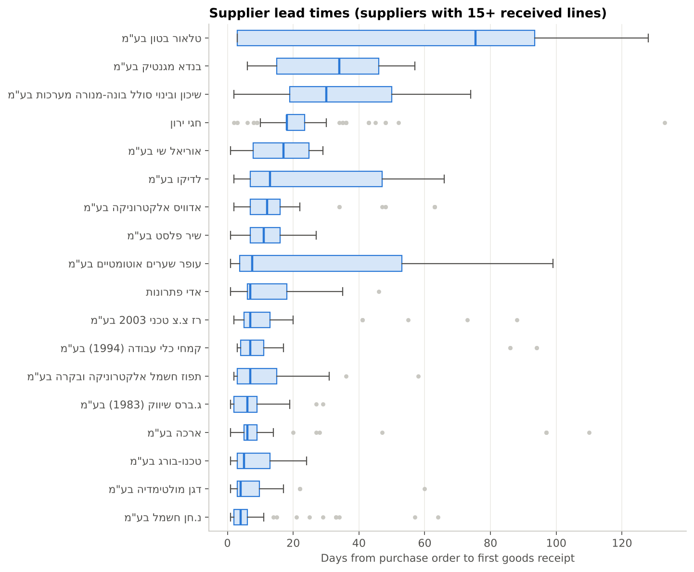
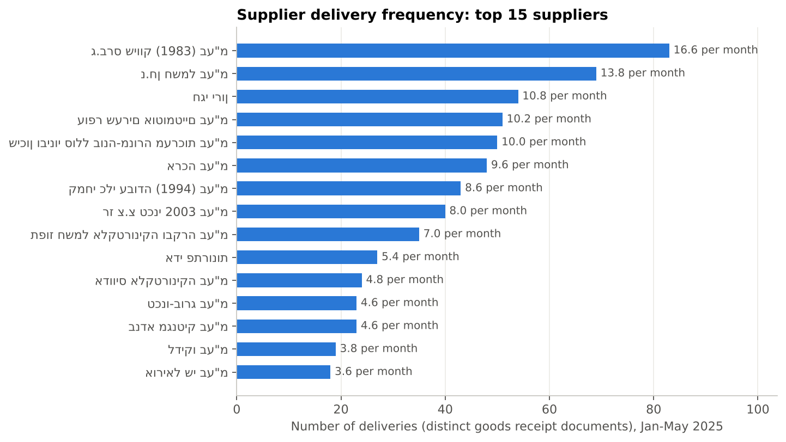

# YSB Inventory and Supply Chain Analysis

Independent analysis of five months of ERP data from YSB, an Israeli infrastructure contractor, covering inventory value, shortages and surpluses, demand stability, supplier lead times and items that are ordered together.

The data is published with YSB's permission.

## Background

I did this project as a Data Analyst at Genesis Accelerator. A startup in the program was building a product that connects a company's operational systems and generates insights from them. To evaluate the product, I was asked to analyse the same YSB data on my own and produce a baseline that the startup's output could be compared against.

This repository contains that baseline: what the data shows, what it cannot show, and what information YSB would need to provide to take the analysis further.

## Key findings

| # | Finding | Number |
|---|---|---|
| 1 | Inventory value is highly concentrated | 6.5% of items in stock hold 80% of the ₪10.7M value |
| 2 | Truly idle stock is small, but a lot of stock moves without a customer order | ₪58K with no movement at all; ₪3.0M (28%) with no customer demand |
| 3 | Half of the apparent shortages are already covered by stock on hand | 733 items flagged by receipts vs demand, 361 after counting opening stock |
| 4 | Surpluses come from bulk-ordered fasteners | One washer item: projected surplus of 38,040 units, about 30× its five-month demand |
| 5 | High-value items have unstable demand | 50 of 65 A items have variable or erratic demand, 58% of consumption value |
| 6 | Supplier lead times have long tails | Median 10 days, but 1 in 10 order lines takes 53 days or more |
| 7 | Clear product kits exist in the orders | 89% of terminal clamp orders include side plates, at a median of about 14 clamps per plate |
| 8 | The supplier base is concentrated, and one frequent supplier is also slow | Top 5 suppliers make up 35% of 879 deliveries; one of them delivers 10 times a month with a 30-day median lead time |
| 9 | Open purchase commitments are large and concentrated | ₪9.8M with no receipt yet; 5 lines make up 42% of it |



## Analysis

The full analysis is in [`notebooks/ysb_operations_analysis.ipynb`](notebooks/ysb_operations_analysis.ipynb).

| Section | Question | Method |
|---|---|---|
| Missing values and cleaning | Is the data complete and consistent? | Empty columns, missing key values, duplicates, invalid quantities, with each cleaning decision documented |
| Data quality | Can the data be trusted, and what are its gaps? | Coverage, status filtering, order-to-receipt matching |
| ABC by stock value | Where is the money tied up? | Pareto split at 80% / 95% of year-end value |
| Idle stock | What is in stock but not used? | Stock with no demand, and with no movement at all; write-offs |
| Projected balance | Which items are really short or in surplus? | Opening stock + receipts − customer demand |
| ABC-XYZ | Which items are both valuable and hard to predict? | Consumption value × coefficient of variation of monthly demand |
| Supplier lead times | How long do suppliers take, and how consistent are they? | Days from purchase order to first goods receipt, by supplier |
| Supplier delivery frequency | Which suppliers does YSB depend on day to day? | Deliveries per supplier and per month, combined with lead time |
| Open commitments | How much is ordered but not yet received? | Order lines with no matching receipt |
| Items ordered together | Which items behave as kits? | Pair counts, confidence, lift and quantity ratio per order |

<table>
<tr>
<td></td>
<td></td>
</tr>
<tr>
<td></td>
<td></td>
</tr>
<tr>
<td></td>
<td></td>
</tr>
</table>

## Data limitations

The analysis explains what the current data can explain. These gaps limit how far it can go:

| Missing information | Why it matters |
|---|---|
| Holding cost per item | Purchase price alone does not show what an item costs to keep in stock |
| Item criticality | A cheap item that stops a project matters more than an expensive optional one |
| Bills of materials and kit definitions | Kits are inferred from orders here; the real definitions would make planning exact |
| Promised delivery dates | The requested-date field equals the order date in 92% of lines, so on-time performance cannot be measured |
| Consumption at project sites | Transfers to sites are not consumption, so idle stock may be sitting there |
| A longer history | Five months is too short for seasonality or reliable forecasts |

The comparison between this baseline and the startup's product was carried out by the startup and the accelerator team.

## What changed from the first version

The first version of this analysis (2025) is kept in [`notebooks/archive/`](notebooks/archive/original_analysis_2025.ipynb), together with the original summary report in Hebrew in [`reports/`](reports/original_findings_summary_he.pdf). This version:

- documents missing values, duplicates and invalid quantities in every table, with an explicit cleaning decision for each;
- counts opening stock in shortage and surplus figures, which changes the picture for many items;
- excludes cancelled, rejected, draft and zero-quantity order lines from demand;
- measures lead time from purchase order to actual receipt only, after finding that the requested-date field is not used;
- keeps supplier delivery frequency from the first version and combines it with lead times;
- adds ABC-XYZ classification, an idle stock check, open commitments and an analysis of items ordered together;
- adds a section on data limitations and the information needed to go further;
- replaces repeated code with one load-and-clean step and English column names.

## Repository structure

```
ysb-operations-analysis/
├── README.md
├── requirements.txt
├── data/                     Raw ERP exports (see data/README.md)
├── notebooks/
│   ├── ysb_operations_analysis.ipynb   Current analysis
│   └── archive/
│       └── original_analysis_2025.ipynb
├── images/                   Charts used in this README
├── outputs/                  Result tables (CSV)
└── reports/
    └── original_findings_summary_he.pdf
```

## How to run

```bash
pip install -r requirements.txt
cd notebooks
jupyter notebook ysb_operations_analysis.ipynb
```

The notebook reads from `data/` and writes charts to `images/` and tables to `outputs/`.

## Tools

Python, pandas, NumPy, Matplotlib, Jupyter.

## Author

**Nir Avrahamoff**, Data Analyst. Project completed at Genesis Accelerator.
